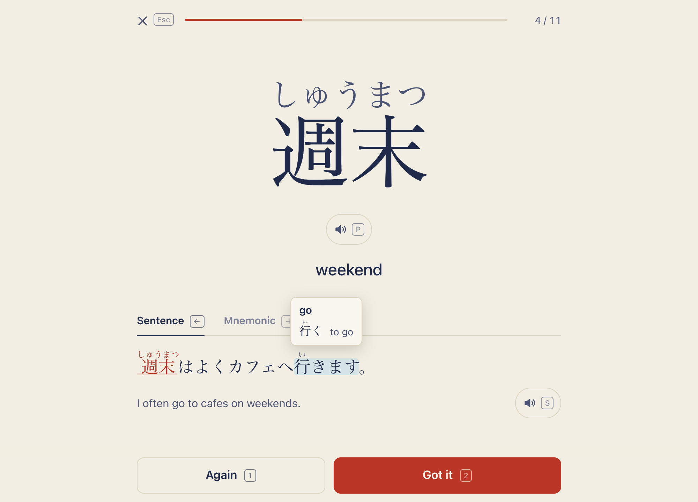
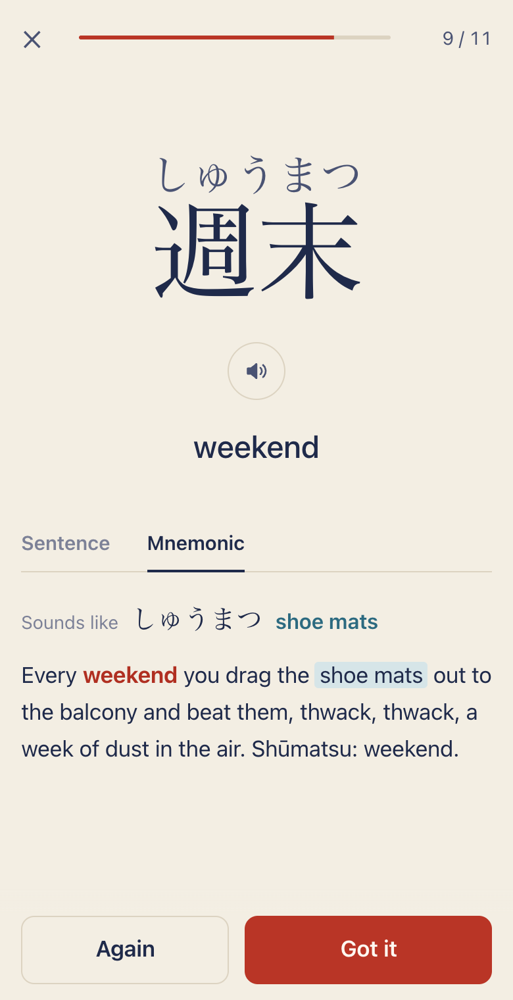
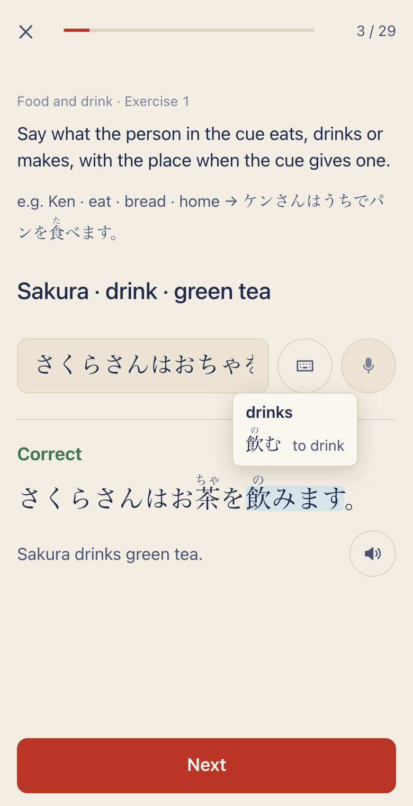
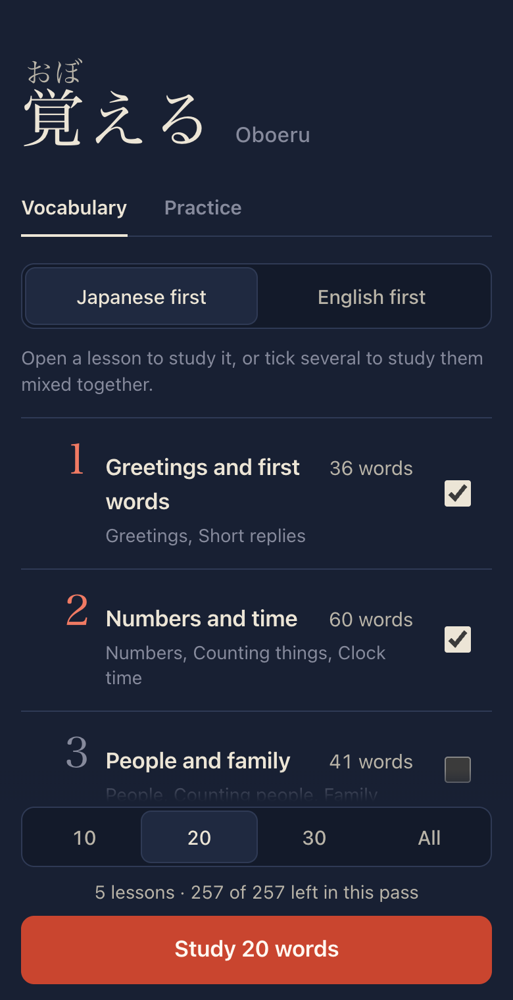

# Oboeru

[](https://github.com/trapp01/Oboeru/actions/workflows/ci.yml)
[](LICENSE)

Flashcards for Japanese vocabulary where every card can explain itself: a spoken
clip, an example sentence you can take apart word by word, and a mnemonic for
the sound. A second tab runs written drills one at a time, typed or spoken.



**Try it:** <https://trapp01.github.io/Oboeru/>

- **A sentence you can take apart.** After the reveal, each word and particle
  of the example sentence shows what it means there when you hover or tap it. A
  conjugated verb also shows its dictionary form.
- **A mnemonic for the sound.** しゅうまつ sounds like "shoe mats"; every
  weekend you drag the shoe mats outside and beat them. One short scene per
  word, built on the keyword method.
- **Sound for everything.** Each word, sentence and practice answer has a
  clip. Nothing plays on its own.
- **Drills you type or say.** Romaji turns into kana as you type, a kana
  keyboard sits under the answer box, and the microphone writes down a spoken
  answer. Kanji or kana both count, and so do digits for numbers.
- **Mix lessons.** Tick several lessons and study 10, 20 or 30 at a time from
  all of them. A word you get first time sits out until every other word has
  come up.
- **No schedule.** Nothing is due tomorrow and there is no streak. It is for
  the practice you sit down to do.
- **Phone and laptop.** One thumb on a phone, the keyboard on a laptop, light
  and dark.
- **Your own word lists.** A lesson is a JSON file. Import a spreadsheet and
  it becomes cards.
- **Only files.** No build step, no dependencies, no account. Copy `site/` to
  any static host.

おぼえる (覚える) means "to memorize".

| Mnemonic | Practice | Phone |
| --- | --- | --- |
|  |  |  |

## The starter deck

The repository comes with a deck written for it: 632 everyday words in 12
topics, from greetings to feeling ill. Every word has a sentence with its
breakdown, a mnemonic and two clips, and every lesson has about thirty drill
items, 382 in all.

The sentences, mnemonics and drills were written by Claude from the briefs in
[docs/notes-guide.md](docs/notes-guide.md) and
[docs/practice-guide.md](docs/practice-guide.md), checked by the validators
and spot-checked by hand. They have not been proofread by a native speaker,
and the clips' pitch accents are the speech engine's. If something is wrong,
please open an issue.

## Run it

Needs Node 22. There is nothing to install.

```sh
git clone https://github.com/trapp01/Oboeru.git && cd Oboeru
npm run serve        # http://localhost:4321
```

Any file server pointed at `site/` works too. The keyboard shortcuts and what
each screen does are in [docs/design.md](docs/design.md).

## Use your own word lists

Oboeru was built to follow a textbook chapter by chapter, and that is still
what it is best at.

1. **Keep your copy private if it will hold a textbook's content.** Clone this
   repository and push it to a private one of your own. Chapter word lists and
   exercises belong to the book's publisher; see
   [Content and licences](#content-and-licences).
2. **Import a chapter.** Put the words in a spreadsheet with a header row:
   `kana` and `meaning`, and optionally `kanji`, `category` and `section`.
   Export it as CSV, then:

   ```sh
   node scripts/import-words.mjs 13 chapter1.csv --title "Chapter 1"
   ```

   That writes `site/data/words/lesson-13.json` and adds the lesson to the
   list; the starter deck uses lessons 1 to 12. The cards work straight away,
   with the browser's Japanese voice. Words are numbered in order (`l13-012`
   is the twelfth), and notes, clips and progress hang on that number, so add
   new words at the end.
3. **Write the notes**, or have a model write them.
   [docs/notes-guide.md](docs/notes-guide.md) is the brief: the format, the
   rules for sentences and mnemonics, and the research behind them.
   `node scripts/validate-notes.mjs 13` checks the result.
4. **Add drills** if you want the Practice tab for that lesson.
   [docs/practice-guide.md](docs/practice-guide.md) covers both exercises you
   write and exercises typed in from a book you own.
5. **Generate the clips** (below).

To start from an empty deck, delete the files in `site/data/words/`,
`site/data/notes/`, `site/data/practice/` and the folders in `site/audio/`,
then run `node scripts/validate-words.mjs --write-index`.

## Clips

`node scripts/generate-audio.mjs` writes the clips for every lesson, or for the
lessons named as arguments. It rebuilds only clips whose text changed. It needs
`ffmpeg` and a [VOICEVOX engine](https://github.com/VOICEVOX/voicevox_engine/releases)
running on the same machine:

```sh
<engine folder>/run --host 127.0.0.1 --port 50021
```

The engine sometimes picks the wrong reading for a kanji (日本 as ニッポン).
The script compares what the engine will say with the furigana in the data
and, on a mismatch, sends the misread word as kana; it prints each such fix,
and `CHECK` for a clip it could not get right. A word that is misread
everywhere belongs in `scripts/voicevox-dict.json`. Run with `--force` after
editing that file.

Without clips the app speaks with the browser's own Japanese voice.

## Deploy

- **Any static host.** Serve `site/`. Progress stays in each browser, and the
  microphone uses the browser's speech recognition, which Firefox and Brave do
  not have.
- **Cloudflare Workers.** `wrangler.jsonc` deploys `site/` with
  `worker/index.js` in front of it, which adds two endpoints:
  `/api/progress` keeps the ticked lessons and cleared words in a KV namespace
  so they follow you between devices, and `/api/transcribe` turns a recorded
  answer into text with Workers AI (`whisper-large-v3-turbo`, billed per audio
  minute). Connect the repository to a Worker in the Cloudflare dashboard and
  it deploys on every push.

  **The endpoints have no login of their own.** A deployment is one person's:
  put it behind [Cloudflare Access](https://developers.cloudflare.com/cloudflare-one/policies/access/)
  (free for personal use), or anyone with the address can overwrite your
  progress and spend your transcription minutes.

## Develop

```sh
npm test             # unit tests (node --test)
npm run validate     # word lists, notes and practice files
```

```
site/                 everything that gets deployed
  src/                browser code, ES modules, no bundler
    lessons/          lesson list and the word list of one lesson
    study/            the session queue, the card screen, the mix
    furigana/         sentence markup, breakdowns and furigana alignment
    audio/            clip playback
    practice/         the Practice tab: answer checking, romaji input, kana keyboard, microphone
  data/               lessons.json, words/, notes/, practice/
  audio/              generated clips
worker/               the Cloudflare Worker: serves site/, syncs progress, transcribes speech
scripts/              the local server, the importer, the validators, the clip generator
docs/                 design.md, glossary.md, notes-guide.md, practice-guide.md
```

Tests sit next to the file they test. [docs/glossary.md](docs/glossary.md)
defines the words the code, the data and the docs share, and
[CLAUDE.md](CLAUDE.md) has the project's rules with their reasons.

## Why

A textbook gives you a word list and a page of drills per chapter, and both are
easy to put off. Oboeru started as a private tool for getting through
[Genki](https://genki3.japantimes.co.jp/en/): tick the chapters covered so far,
flip twenty words on the train, type twenty drill answers at a desk, and have
each card explain itself at the moment you miss it.

The mnemonics follow the keyword method (Atkinson & Raugh, 1975): an English
phrase that sounds like the word, and one scene where it meets the meaning.
The studies behind it also say the advantage fades unless the word is recalled
from memory, and that a hint shown before the attempt hurts. So the card asks
first and explains after. [docs/notes-guide.md](docs/notes-guide.md) has the
sources.

That private copy holds the textbook's own lists and exercises, which are not
mine to share. This repository is the same app with a deck written for it.

## Contributing

[CONTRIBUTING.md](CONTRIBUTING.md) has the rules. The one that matters most:
nothing copied from a textbook, a workbook or another app goes into this
repository.

## Content and licences

- **Code** is under the [MIT licence](LICENSE).
- **The starter deck** (the word lists, notes and practice files in
  `site/data/`) is original to this project and under
  [CC BY 4.0](https://creativecommons.org/licenses/by/4.0/). Its words are
  common beginner vocabulary, chosen and grouped by topic here; no list,
  sentence, exercise or character is taken from a textbook.
- **The clips** in `site/audio/` are synthesized with
  [VOICEVOX](https://voicevox.hiroshiba.jp/), voice 四国めたん. They are not
  under the licences above: they may be used under the terms of VOICEVOX and of
  the voice, which ask for the credit "VOICEVOX:四国めたん" wherever the audio
  is used. The app shows it under the lesson list.
  [ATTRIBUTION.md](ATTRIBUTION.md) has the links.
- **Your own copy.** Single words and their translations are facts, but a
  textbook's selection and ordering of them, its exercises and its answer key
  are the publisher's. If you load them into a copy for your own study, keep
  that repository private and its site behind a login.

Oboeru is an independent project. It is not affiliated with or endorsed by The
Japan Times, the publisher of Genki, or by any other publisher.
